# executionContext 诊断进展与 A/B 实验

> 关联问题：`executionContextId` 探测失败（`Known contexts: none`）
> 前置：P0（frida 25715 适配，commit 11beae9）已完成，frida 注入与调试桥回连均正常
> 状态：B/A 实验已完成，定位到 A/B 矛盾与进程实例差异，待决策下一步

---

## 一、进展概览

| 阶段 | 结论 |
| --- | --- |
| P0 frida 25715 适配 | 完成，全链路验证通过（hook 触发→scene 改写→WS URL→miniapp 回连） |
| B 实验（Fork, pid 56660） | miniapp 回连，DevTools 能看 Console，但 executionContextCreated 仅 `DevTools Performance Metrics`，无 gameContext |
| A 实验（WMPFDebugger 原版, pid 1316 干净环境） | OnLoadStart 触发 18 次但 scene 全不匹配，miniapp 不回连，DevTools 空白 |
| 核心矛盾 | 相同 hook/config，56660 能 scene=1005，1316 读不到 |

---

## 二、三个判断修正

诊断过程中修正了三个早期判断，避免下一步走偏：

1. **`Runtime.addBinding` 不创建 Context**：根据 [CDP 官方文档](https://chromedevtools.github.io/devtools-protocol/tot/Runtime/#method-addBinding)，`addBinding` 是向现有/未来执行上下文注册绑定，不创建 Context。因此观察到 `DevTools Performance Metrics` Context 不能归因于 `addBinding`，也不能据此认定游戏 Context 完全不存在。
2. **close code=1001 不能断定页面导航**：`1001` 是 "Going Away"，可能由页面导航/卸载引起，但不能仅凭状态码确认一定是导航，需结合 close code/reason/连接代次综合判断。
3. **不贸然引入 `Target.attachToTarget`**：DevTools 命令带 `sessionId` 提示可能涉及多 Target/Session，但尚未观察到 `Target.targetCreated` / `Target.attachedToTarget` 记录，不能断定 25715 必须先 `attachToTarget`。

---

## 三、WS 诊断改动（已实现，未提交）

为支持诊断，在 `wmpf/src/index.js` 的 `debug_server` 增加了 WebSocket 连接生命周期日志（不改协议行为）：

- 每个 9421 连接分配递增 `cid`（`nextConnectionId`）。
- `connected` 日志带 `active`（当前连接数）。
- `close` 日志带 `code` / `reason` / `duration` / `active` / `cats{类别=计数}`。
- `onMessage(ws, message)` 按消息类别累计每连接的 `catCounts`（setupContext / chromeDevtoolsResult / decode_error / unknown 等）。

示例输出：

```
[miniapp][ws#2] connected active=1
[miniapp][ws#2] closed code=1001 reason= duration=556ms active=0 cats{setupContext=1 chromeDevtoolsResult=39}
```

该改动仅在本地工作区，尚未提交。

---

## 四、B 实验（Fork, pid 56660）

环境：`node run.cjs --wx --debug-frida --debug-main`，注入旧主进程 56660，用户打开微信端 QQ 农场 + Chrome 连 `devtools://...ws=127.0.0.1:62000`。

### 4.1 frida hook 全链路通过

```
[frida client] [inteceptor] AppletIndexContainer::OnLoadStart onEnter, indexContainer.this: 0x68b40ab1b180
[frida client] [hook] scene: 1005
[frida client] [hook] hook scene condition -> 1101
[frida client] [hook] websocket url -> ws://localhost:9421
[frida client] [hook] remote debug mode: 0 -> 1
[miniapp][ws#1] connected active=1
```

### 4.2 WS 连接反复以 1001 关闭

```
ws#1 closed code=1001 duration=152ms  cats{setupContext=1}
ws#2 closed code=1001 duration=556ms  cats{setupContext=1 chromeDevtoolsResult=39}
ws#3 closed code=1001 duration=4514ms cats{setupContext=1 chromeDevtoolsResult=17}
```

对应 [WMPFDebugger Issue #8：Mini Client disconnects on any navigation](https://github.com/evi0s/WMPFDebugger/issues/8)。连接存活极短（152ms~4514ms），CDP 会话难以稳定。

### 4.3 Runtime.enable 有响应，但无 gameContext

```
payload: '{"id":1000029603,"method":"Runtime.enable","params":{}}'   # 网关发，jscontext_id=''
[miniapp] [DEBUG] cdp response id=1000029603                          # 有响应
```

DevTools 连 62000 后，上游 CDP 命令带 `sessionId`：

```
{"id":8,"method":"Runtime.enable","params":{}}
{"id":29,"method":"Runtime.addBinding","params":{"name":"__chromium_devtools_metrics_reporter","executionContextName":"DevTools Performance Metrics"}}
{"id":53,"method":"Runtime.enable","params":{},"sessionId":"AB428F2E09EFCADAAE864E29F8602524"}
```

仅记录到 1 次 executionContextCreated：

```
[miniapp] [DEBUG] cdp event Runtime.executionContextCreated id=12 name=DevTools Performance Metrics origin=
```

**结论**：CDP 通道通（Runtime.enable 有响应、DevTools 能看 Console），但游戏 gameContext 的 executionContextCreated 未上报。

---

## 五、A 实验（WMPFDebugger 原版, pid 1316 干净环境）

环境：克隆上游 WMPFDebugger（GPL-2.0），`npx ts-node src/index.ts --debug-frida --debug-main`。先杀所有 WeChatAppEx 清理 Fork 的 frida session 残留，微信重启出全新主进程 1316，再注入。

### 5.1 注入成功

```
[frida] script loaded, WMPF version: 25715, pid: 1316
```

版本检测走 `--flue-runtime-dir` 命令行参数（`src/platform/win32.ts:36-45`），与 Fork 的 PowerShell FileVersion 方式不同但结果一致。

### 5.2 OnLoadStart 触发但 scene 全不匹配

```
[frida client] [inteceptor] AppletIndexContainer::OnLoadStart onEnter, indexContainer.this: 0x242c095c59e0
...（共 18 次，全部无 [hook] scene）
```

`handleOnLoadStart`（`frida/hook.js:77-176`）的 `miniappScenePtr.readInt()` 读到的值不在 `sceneNumberArray`（1005/1007/.../1308）中，被 `return` 跳过，不发 `[hook] scene`，不执行 scene 改写与 WS URL 设置。

### 5.3 miniapp 不回连，DevTools 空白

9421 Established=0，62000 无 DevTools 有效数据，无法执行 `Runtime.evaluate`。

---

## 六、A/B 矛盾

| 项 | B（Fork, 56660） | A（WMPFDebugger, 1316） |
| --- | --- | --- |
| hook.js / config | 几乎一致 | 完全一致（上游原版） |
| 偏移（25715） | MiniAppConfigStructOffsets | 同 |
| OnLoadStart 首次 | scene=1005 → 改写 1101 → WS URL → 回连 | 18 次全不匹配 |
| miniapp 回连 | 成功 | 失败 |
| gameContext | 未上报（仅 DevTools Performance Metrics） | 无法验证 |

相同 hook、相同 config，56660 能读到 scene=1005，1316 读不到。最可能源于**进程实例差异**：杀 WeChatAppEx 重启后，1316 的进程角色/内存布局与 56660 不同，或 `findWmpfProcess`（ppid 最多逻辑）选到的主进程实例不同，导致 `MiniAppConfigStructOffsets` 定位 scene 时读到不匹配的值。

---

## 七、A/B 诊断对比

```mermaid
flowchart TD
    subgraph B实验 [B 实验 Fork 注入 pid 56660]
        B1[OnLoadStart 触发] --> B2[scene 1005 匹配]
        B2 --> B3[改写 1101 设 WS URL 设 debug mode]
        B3 --> B4[miniapp 回连 9421]
        B4 --> B5[DevTools 能看 Console]
        B5 --> B6[executionContextCreated 仅 DevTools Performance Metrics]
        B6 --> B7[无 gameContext 探测失败]
    end
    subgraph A实验 [A 实验 WMPFDebugger 注入 pid 1316 干净环境]
        A1[OnLoadStart 触发 18 次] --> A2[scene 全不匹配]
        A2 --> A3[无改写 无 WS URL]
        A3 --> A4[miniapp 不回连]
        A4 --> A5[DevTools 空白 无法执行 JS]
    end
```



---

## 八、判断矩阵定位

| 结果 | 下一步 |
| --- | --- |
| A 可执行游戏 JS，B 不行 | 排查 Fork CDP 路由与会话管理 |
| A、B 都只能看日志，无法执行 JS | 调查上游 25715 与该小游戏兼容性 |
| A、B 都可执行 JS，只有网关失败 | 修复 WmpfCdpSession 的 Target/Session/Context 选择 |
| A、B 都反复重连，但至少一方可执行 JS | 重点分析会话恢复机制 |

当前：**A 干净环境下连 miniapp 都不回连（比 B 退步），B 下 miniapp 回连但无 gameContext**。两者都无法在真实游戏 Context 执行 `Runtime.evaluate`。更接近"A、B 都异常"，但程度不同，且 A/B 之间存在进程实例差异导致的矛盾，不能直接定性为 25715 自身 Bug。

---

## 九、未决问题与下一步选项

### 未决问题

1. **56660 为何能 scene=1005 而 1316 不能**：进程实例差异的具体机制未明（角色？flue.dll 基址？indexContainer 布局？）。
2. **gameContext 的 executionContextCreated 为何不上报**：B 下 CDP 通道通、Runtime.enable 有响应，但游戏真实 context 事件缺失，是否需要 Target/session 路径或额外 hook。
3. **WS 反复 1001 断连**：是游戏重载循环还是其他原因，是否阻断 context 上报。

### 下一步选项

1. **回到 Fork（B）环境聚焦 executionContext**：B 已有 miniapp 回连 + CDP 通道通的进展，问题聚焦在 gameContext 缺失。优先验证用户建议的 `Runtime.evaluate`（不指定 contextId）只读探测，判断 JS Runtime 是否真正可用。
2. **排查 1316 scene 不匹配**：需在 WMPFDebugger hook 临时加 scene 诊断输出（违背"A 实验不改 hook"原则），或对比 56660/1316 进程角色。
3. **实现生命周期修复**（用户建议的第三阶段）：按 `connectionId + generation` 管理会话，断线失效 `_runtimeEnabled` 与 `executionContextId`，但不误清其他有效连接。

---

## 十、关键证据与位置

| 证据 | 位置 |
| --- | --- |
| B 实验日志 | 临时 `farm-B.log`（ws#1-4 + close code=1001 + executionContextCreated id=12） |
| A 实验日志 | 临时 `wmpf-A3.log`（OnLoadStart 18 次无 [hook] scene） |
| WS 诊断改动 | `wmpf/src/index.js` `debug_server`（nextConnectionId + catCounts + close 日志） |
| WMPFDebugger 版本检测 | `src/platform/win32.ts:36-45`（--flue-runtime-dir） |
| handleOnLoadStart | `wmpf/frida/hook.js`（Fork）/ `frida/hook.js`（WMPFDebugger，逻辑一致） |
| selectExecutionContext | `wmpf/src/cdp_automation.js:676-712` |
| _prepareGameContext | `src/cdp-wmpf-session.js:224-268` |

---

## 十一、参考引用

- 上游仓库：https://github.com/linguo2625469/qq-farm-cdp-auto
- 本项目 fork：https://github.com/mickorz/qq-farm-cdp-auto
- WMPFDebugger：https://github.com/evi0s/WMPFDebugger
- WMPFDebugger Issue #8（导航断连）：https://github.com/evi0s/WMPFDebugger/issues/8
- WMPFDebugger Issue #282（25715 有问题）：https://github.com/evi0s/WMPFDebugger/issues/282
- Chrome DevTools Protocol（Runtime.addBinding）：https://chromedevtools.github.io/devtools-protocol/tot/Runtime/#method-addBinding
- 关联文档：`docs/frida版本配置缺失注意事项.md`（P0 适配方案）
- 关联文档：`docs/executionContext探测失败注意事项.md`（初步分析）
