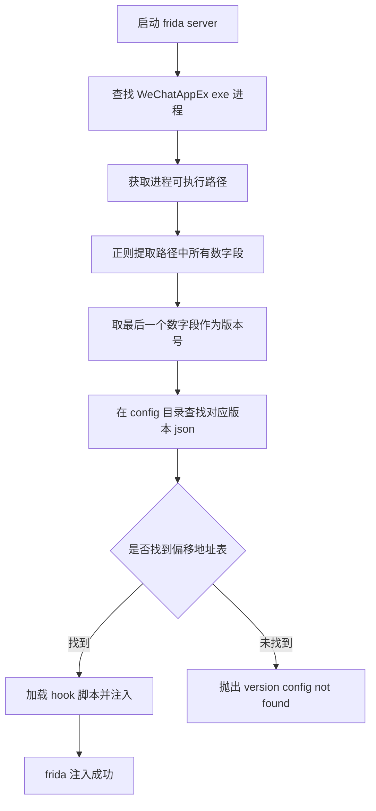
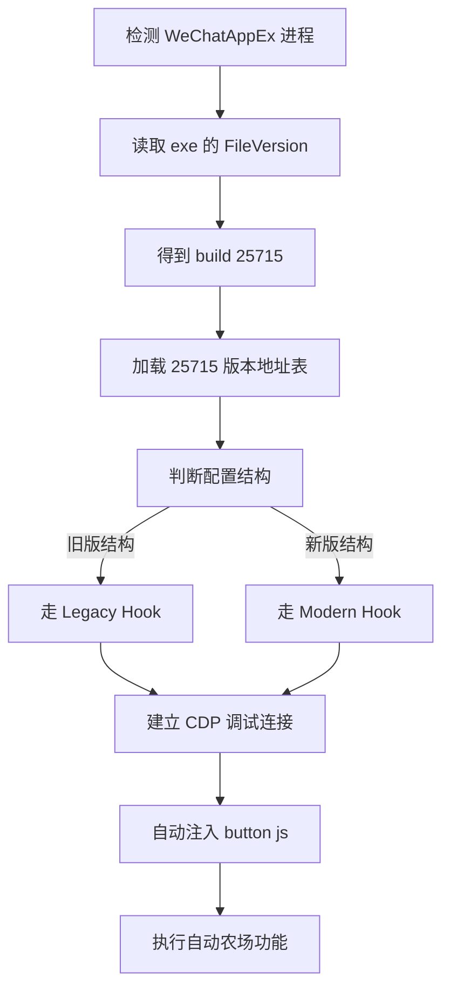

# frida 版本配置缺失问题与新版本适配方案

> 关联报错：`[frida] startup failed: Error: [frida] version config not found: 95`
> 运行命令：`npm run start:wx`
> 状态：根因已确认；适配方向已由「等待上游逆向」更新为「复用现成配置并适配新版 Hook 结构」

---

## 一、问题现象

执行 `npm run start:wx` 启动微信小游戏 CDP 自动化网关时，frida 注入阶段启动失败，关键日志如下：

```
[frida] startup failed: Error: [frida] version config not found: 95
    at frida_server (E:\CocosProjects\qq-farm-cdp-auto\wmpf\src\index.js:341:15)
    at async E:\CocosProjects\qq-farm-cdp-auto\wmpf\src\index.js:374:17
```

frida 子系统启动失败后，网关仍会打印 `等待小游戏调试连接，再自动探测 executionContextId`，但后续 CDP 自动化链路（frida hook 注入）实际不可用，自动化无法真正执行。

---

## 二、环境信息

| 项 | 值 |
| --- | --- |
| 运行平台 | win32 |
| WeChatAppEx 可执行路径 | `C:\Users\zhangqi95\AppData\Roaming\Tencent\xwechat\xplugin\plugins\RadiumWMPF\WeChatAppEx.exe` |
| WeChatAppEx 文件版本 | `2.5.7.25715`（build 号 25715） |
| 已安装配置版本范围 | 11581 ~ 19895（共 36 个，位于 `wmpf/frida/config/`） |
| 报错提取到的版本号 | 95 |
| 本仓库许可证 | GPL-3.0 |

---

## 三、根因分析

报错由两个相互独立的问题叠加造成。

### 1. 版本号提取逻辑存在缺陷（直接原因）

`wmpf/src/index.js:313-318` 用正则从 exe 路径里取「最后一个数字段」当作版本号：

```js
const wmpfVersionMatch = wmpfProcessPath.match(/\d+/g);
const wmpfVersion = wmpfVersionMatch ? new Number(wmpfVersionMatch.pop()) : 0;
```

当前 `WeChatAppEx.exe` 路径为：

```
C:\Users\zhangqi95\AppData\Roaming\Tencent\xwechat\xplugin\plugins\RadiumWMPF\WeChatAppEx.exe
```

路径中最后一个含数字的片段是用户名 `zhangqi95`，`.match(/\d+/g).pop()` 取到的正是其中的 `95`，于是去查找 `addresses.95.json`，自然找不到。`95` 并非 WeChatAppEx 的版本号，而是用户名里携带的数字被误判为版本号。

### 2. 当前版本超出已适配范围（根本原因）

新版 `RadiumWMPF` 的安装路径中不再包含独立版本号目录，真实版本号需从 exe 文件属性获取，其 `FileVersion` 为 `2.5.7.25715`，build 号为 `25715`。而项目 `wmpf/frida/config/` 下现有配置最高仅到 `19895`，`25715` 远超已适配范围。

即便修复第 1 点的提取逻辑，仍会报 `version config not found: 25715`，因为缺少 `addresses.25715.json`。

---

## 四、版本号提取与配置匹配流程



当前实际路径的提取结果（说明误判来源）：


---

## 五、偏移地址表的含义

`wmpf/frida/config/addresses.<version>.json` 是该版本 WeChatAppEx 的 frida hook 内存偏移地址表。每个版本编译不同，偏移地址随版本变化。以 `addresses.19895.json` 为例：

```json
{
  "Version": 19895,
  "LoadStartHookOffset": "0x25CE270",
  "CDPFilterHookOffset": "0x30A9330",
  "ResourceCachePolicyHookOffset": "0x2646390",
  "SceneOffsets": [1472, 1408, 456],
  "ScenePathOffsets": [64, 8, 16]
}
```

现有 `wmpf/frida/hook.js` 读取的字段经核实为：`config.LoadStartHookOffset`、`config.CDPFilterHookOffset`、`config.SceneOffsets`、`config.ScenePathOffsets`，其中 CDP Filter 使用 `Interceptor.attach`。

---

## 六、适配方向更新（核心变更）

### 6.1 过时结论修正

本文档前一版本曾结论「偏移地址表必须由具备逆向能力的维护者提供，普通用户无法生成，需请求上游适配」。该结论现已过时。

实际上 `evi0s/WMPFDebugger` 已为 25715 版本提供现成的偏移地址表与新版 hook 实现，该仓库正是 qq-farm-cdp-auto 所用底层 Hook 技术的来源。因此适配方向应更新为：**复用已有版本配置并适配新版 Hook 结构**，不必从零逆向，也不必单纯等待上游。

### 6.2 现成适配来源

| 资源 | 地址 |
| --- | --- |
| 仓库 | https://github.com/evi0s/WMPFDebugger |
| 25715 偏移配置 | https://github.com/evi0s/WMPFDebugger/blob/main/frida/config/win32/addresses.25715.json |
| 新版 hook 脚本 | https://github.com/evi0s/WMPFDebugger/blob/main/frida/hook.js |

新版 25715 配置内容：

```json
{
  "Version": 25715,
  "LoadStartHookOffset": "0x2D456B0",
  "CDPFilterHookOffset": "0x381C1D0",
  "CastToJsonHookOffset": "0x9EC7870",
  "MiniAppConfigStructOffsets": {
    "LaunchConfigOffsets": [64, 1568, 8],
    "RemoteDebugConfigOffsets": [1504, 16],
    "SceneOffset": 456,
    "WebSocketURLStringOffset": 616,
    "RemoteDebugModeOffset": 724
  }
}
```

### 6.3 新旧配置结构对比

| 功能 | 旧版 19895 | 新版 25715 |
| --- | --- | --- |
| CDP Filter | `Interceptor.attach` | `Interceptor.replace` + `CastToJson` |
| 场景定位 | `SceneOffsets`（数组） | `MiniAppConfigStructOffsets`（嵌套对象） |
| 资源缓存 | `ResourceCachePolicyHookOffset` | 已移除 |
| 类型转换 | 无 | 新增 `CastToJsonHookOffset` |
| WebSocket URL | 旧调试路径 | 需显式设置 URL（`WebSocketURLStringOffset`） |
| Remote Debug Mode | 旧版 Hook 方式 | 新增 `RemoteDebugModeOffset` 并写入 |
| Hook 参数结构 | 旧结构 | 新结构（`LaunchConfigOffsets` / `RemoteDebugConfigOffsets`） |

### 6.4 不能直接套用旧 hook.js 的原因

关键风险：新版 JSON 不再提供顶层 `SceneOffsets` 与 `ScenePathOffsets`。若沿用现有 `wmpf/frida/hook.js`，`config.SceneOffsets` 将取到 `undefined`，随后 `sceneOffsets[0]` 等访问会抛错，可能导致宿主进程异常甚至崩溃。

因此本次适配不能「只放一个 addresses.25715.json 进去」，必须同步升级 hook 脚本，并让新旧两套配置与逻辑能共存。

---

## 七、Fork 修复计划

针对 `mickorz/qq-farm-cdp-auto` 的分阶段改动。

### P0 修复版本识别

修改 `wmpf/src/index.js`，改为从 exe 的 Windows `FileVersion` 属性获取 build 号（如 `2.5.7.25715` 的末段 `25715`），不再从路径正则取数。加入文件版本读取失败时的明确报错，避免静默退化。

预期：版本检测输出 `25715`，不再是 `95`。

### P0 引入新版地址配置

将 WMPFDebugger 中经核对的 `addresses.25715.json` 引入 `wmpf/frida/config/`。

### P0 适配新版 Hook

参考 WMPFDebugger 新版 `hook.js` 重写 `wmpf/frida/hook.js`，需同时处理：

- CDP Filter 由 `Interceptor.attach` 改为 `Interceptor.replace` + `CastToJson`
- 场景定位改用 `MiniAppConfigStructOffsets` 嵌套结构
- 显式设置 WebSocket URL
- 写入 Remote Debug Mode

同时保留旧配置的兼容路径：按配置结构（是否存在 `MiniAppConfigStructOffsets`）分流到 Legacy Hook 或 Modern Hook，使旧版本仍可用。

### P1 增加自动化验收

按版本识别、配置加载、frida 注入、小游戏 CDP 连接、`button.js` 注入、`gameCtl.*` 调用的顺序逐项验证。

---

## 八、实施流程



---

## 九、验收标准

按下表顺序逐项验证，而非仅看启动日志：

| 验收项 | 预期 |
| --- | --- |
| 版本检测 | `25715`，不再是 `95` |
| 加载地址表 | 成功加载 `addresses.25715.json` |
| Frida Hook | 加载成功且宿主进程未崩溃 |
| 小游戏调试连接 | 收到真实连接事件 |
| CDP 上下文 | 获得有效 `executionContextId` |
| 自动注入 | `button.js` 成功执行 |
| 功能测试 | 能通过 `gameCtl` 读取游戏状态 |

---

## 十、许可证兼容性注意

WMPFDebugger 标注为 GPL-2.0，本仓库为 GPL-3.0。两者许可条款不完全一致，分发前需谨慎：

- 本地兼容性实验可先行进行（不涉及公开分发）。
- 若要将 WMPFDebugger 的 Hook 代码完整复制并随本仓库公开分发，应先确认其具体授权条款（是否为「GPL-2.0 or later」）及与 GPL-3.0 的兼容性。
- 不确定时，优先以「参考实现 + 自行编写等价逻辑」的方式适配，降低许可证耦合风险。

---

## 十一、架构优化建议

本次修复建议顺便把 Frida Hook 层与农场业务代码分离：

- frida 注入、CDP 通道、版本配置解析统一收敛到 `wmpf/`。
- `button.js` 与自动农场逻辑只依赖稳定的 CDP 接口，不直接触碰版本相关偏移。
- 目标：今后微信运行时升级时，只需更新 `wmpf/` 下的配置与 hook，不影响 `button.js` 及自动农场逻辑。

---

## 十二、参考引用

- 现成适配来源：https://github.com/evi0s/WMPFDebugger
- 25715 偏移配置：https://github.com/evi0s/WMPFDebugger/blob/main/frida/config/win32/addresses.25715.json
- 新版 hook 脚本：https://github.com/evi0s/WMPFDebugger/blob/main/frida/hook.js
- 上游仓库：https://github.com/linguo2625469/qq-farm-cdp-auto
- 本项目 fork：https://github.com/mickorz/qq-farm-cdp-auto
- frida 官方文档：https://frida.re
- 报错源码位置：`wmpf/src/index.js:341`（`frida_server` 函数）
- 偏移地址表目录：`wmpf/frida/config/`
- 现有 hook 脚本：`wmpf/frida/hook.js`
